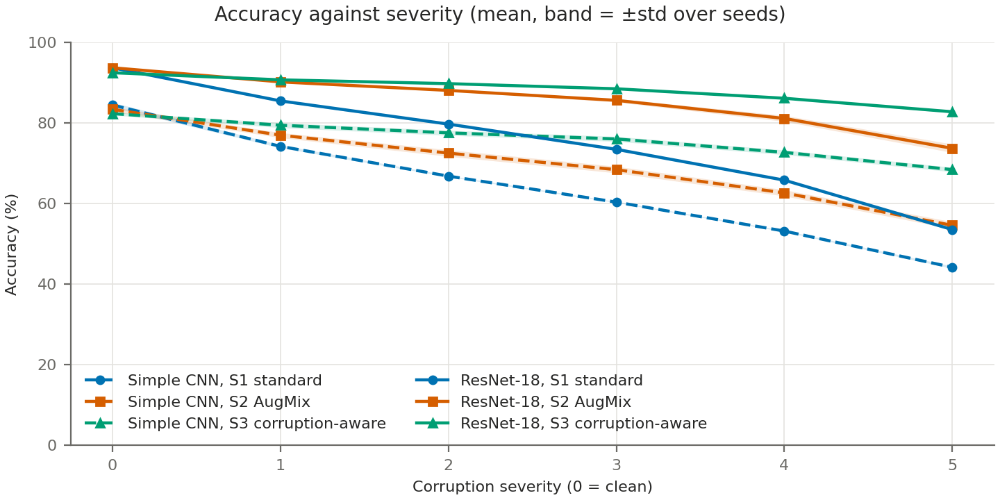
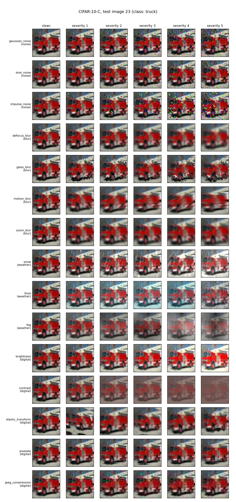

# CIFAR-10 Robustness Study

**An empirical study of how image classifiers fail under common image corruptions, and how robustness-oriented training reduces that failure, with reproducible PyTorch code on CIFAR-10-C.**

We train a Simple CNN and ResNet-18 from scratch on CIFAR-10 with three training strategies (standard, AugMix, corruption-aware), 3 seeds each, and test them on clean CIFAR-10 and on CIFAR-10-C: 15 corruption types (noise, blur, weather, digital) at 5 severity levels. Every number below is filled in by a script from the result files.

- **Report:** [report/report.md](report/report.md)
- **Live demo:** coming in a later phase (link to be added)



## Results

Mean ± std over 3 seeds. mCE (lower is better) uses the Simple CNN with standard training as the 100% reference.

| Model | Strategy | Clean accuracy | Mean corrupted accuracy | Drop | mCE | Relative mCE |
|---|---|---|---|---|---|---|
| Simple CNN | standard | {{main.cnn.standard.clean_acc.mean|pct1}} ± {{main.cnn.standard.clean_acc.std|pct1}} | {{main.cnn.standard.mean_corrupted_acc.mean|pct1}} ± {{main.cnn.standard.mean_corrupted_acc.std|pct1}} | {{main.cnn.standard.mean_abs_degradation.mean|pp1}} | {{main.cnn.standard.mce.mean|pct1}} | {{main.cnn.standard.relative_mce.mean|pct1}} |
| Simple CNN | AugMix | {{main.cnn.augmix.clean_acc.mean|pct1}} ± {{main.cnn.augmix.clean_acc.std|pct1}} | {{main.cnn.augmix.mean_corrupted_acc.mean|pct1}} ± {{main.cnn.augmix.mean_corrupted_acc.std|pct1}} | {{main.cnn.augmix.mean_abs_degradation.mean|pp1}} | {{main.cnn.augmix.mce.mean|pct1}} | {{main.cnn.augmix.relative_mce.mean|pct1}} |
| Simple CNN | corruption-aware | {{main.cnn.corruption_aware.clean_acc.mean|pct1}} ± {{main.cnn.corruption_aware.clean_acc.std|pct1}} | {{main.cnn.corruption_aware.mean_corrupted_acc.mean|pct1}} ± {{main.cnn.corruption_aware.mean_corrupted_acc.std|pct1}} | {{main.cnn.corruption_aware.mean_abs_degradation.mean|pp1}} | {{main.cnn.corruption_aware.mce.mean|pct1}} | {{main.cnn.corruption_aware.relative_mce.mean|pct1}} |
| ResNet-18 | standard | {{main.resnet18.standard.clean_acc.mean|pct1}} ± {{main.resnet18.standard.clean_acc.std|pct1}} | {{main.resnet18.standard.mean_corrupted_acc.mean|pct1}} ± {{main.resnet18.standard.mean_corrupted_acc.std|pct1}} | {{main.resnet18.standard.mean_abs_degradation.mean|pp1}} | {{main.resnet18.standard.mce.mean|pct1}} | {{main.resnet18.standard.relative_mce.mean|pct1}} |
| ResNet-18 | AugMix | {{main.resnet18.augmix.clean_acc.mean|pct1}} ± {{main.resnet18.augmix.clean_acc.std|pct1}} | {{main.resnet18.augmix.mean_corrupted_acc.mean|pct1}} ± {{main.resnet18.augmix.mean_corrupted_acc.std|pct1}} | {{main.resnet18.augmix.mean_abs_degradation.mean|pp1}} | {{main.resnet18.augmix.mce.mean|pct1}} | {{main.resnet18.augmix.relative_mce.mean|pct1}} |
| ResNet-18 | corruption-aware | {{main.resnet18.corruption_aware.clean_acc.mean|pct1}} ± {{main.resnet18.corruption_aware.clean_acc.std|pct1}} | {{main.resnet18.corruption_aware.mean_corrupted_acc.mean|pct1}} ± {{main.resnet18.corruption_aware.mean_corrupted_acc.std|pct1}} | {{main.resnet18.corruption_aware.mean_abs_degradation.mean|pp1}} | {{main.resnet18.corruption_aware.mce.mean|pct1}} | {{main.resnet18.corruption_aware.relative_mce.mean|pct1}} |

## Key findings

- **Corruptions cost a lot of accuracy, more at higher severity.** With standard training ResNet-18 drops from {{main.resnet18.standard.clean_acc.mean|pct1}} on clean images to {{main.resnet18.standard.mean_corrupted_acc.mean|pct1}} on average over all corruptions, and by {{rq1.resnet18.standard.abs_drop_sev5|pp1}} at the highest severity.
- **A stronger architecture is more accurate, but not much more robust.** ResNet-18's mCE is {{rq2.standard.mce.resnet18_minus_cnn|negpp1}} below the Simple CNN's, but its relative mCE, which counts only the error the corruptions add, is just {{rq2.standard.relative_mce.resnet18_minus_cnn|negpp1}} lower.
- **Training matters more than architecture.** For ResNet-18, AugMix raises mean corrupted accuracy by {{rq3.resnet18.augmix.mean_corrupted_acc.diff_vs_standard|pp1}} with no measurable cost on clean images; corruption-aware training raises it by {{rq3.resnet18.corruption_aware.mean_corrupted_acc.diff_vs_standard|pp1}} but lowers clean accuracy by {{rq3.resnet18.corruption_aware.clean_acc.diff_vs_standard|negpp1}}.
- **Corruption-aware training generalises only partly.** Its gain is {{rq4.resnet18.corruption_aware.seen_gain_vs_standard|pp1}} on the corruptions it trained on, {{rq4.resnet18.corruption_aware.unseen_same_family_gain_vs_standard|pp1}} on unseen ones from the same families, and {{rq4.resnet18.corruption_aware.unseen_other_family_gain_vs_standard|pp1}} on snow, frost and fog (ResNet-18).
- **Noise and blur hurt the most, brightness the least.** With standard training ResNet-18 loses {{rq5.resnet18.standard.noise.abs_degradation|pp1}} on noise and {{rq5.resnet18.standard.blur.abs_degradation|pp1}} on blur, but only {{rq5.resnet18.standard.brightness.abs_degradation|pp1}} on brightness.

These hold on 32x32 CIFAR-10 images with synthetic corruptions; see the report's limitations before drawing wider conclusions.



## Reproduce

Everything below runs from the repository root. Python 3.10+; the analysis steps need no GPU.

**Set up** (once):

```bash
git clone https://github.com/aysha0559/Image-Classification-with-ResNet-18.git
cd Image-Classification-with-ResNet-18
python3.12 -m venv .venv
.venv/bin/pip install -r requirements-local.txt -r requirements.txt
```

**1. View the results only.** Nothing to run: the report is [report/report.md](report/report.md), the tables are in [results/tables/](results/tables/) and the figures in [results/figures/](results/figures/). For example:

```bash
cat results/tables/main_results.md
```

**2. Re-run the analysis from the committed result CSVs** (CPU only):

```bash
.venv/bin/python -m src.analysis
.venv/bin/python -m scripts.make_figures
.venv/bin/python -m scripts.build_report
```

This rebuilds `results/tables/`, the figures and this README and the report from `results/raw/` and `results/runs.csv`.

**3. Re-run one experiment on Google Colab** (free T4 GPU). Open [notebooks/run_on_colab.ipynb in Colab](https://colab.research.google.com/github/aysha0559/Image-Classification-with-ResNet-18/blob/main/notebooks/run_on_colab.ipynb), choose a GPU runtime, set the parameters in the first code cell, for example

```python
MODEL = "resnet18"
STRATEGY = "augmix"
STAGE = "both"
```

with `SEED` left at its default, then Runtime > Run all. The notebook mounts Google Drive, downloads and checks CIFAR-10-C, trains, evaluates and saves the results under `MyDrive/cifar10-robustness/`. Training resumes from the last checkpoint if the session ends. On a machine with an NVIDIA GPU you can run the same steps directly:

```bash
.venv/bin/python -m scripts.download_cifar10c
.venv/bin/python -m src.train --config configs/resnet18_augmix.yaml --seed 0
.venv/bin/python -m src.evaluate --run-dir runs/resnet18-augmix-s0
```

**4. Re-run everything.** In the Colab notebook leave `STAGE = "matrix"` and run all; each session trains and evaluates as many runs as fit, and running it again continues where it stopped. On your own GPU machine: `bash scripts/run_all.sh`. Training all 18 runs took {{compute.train_hours_total|f1}} GPU hours on T4 GPUs, plus evaluation and setup. Then copy the results in and run step 2:

```bash
.venv/bin/python -m scripts.collect_results --from <downloaded results folder>
```

## Repository layout

```
configs/            one YAML file per model and strategy
src/                data loading, our seen corruptions, models, training, evaluation, metrics, analysis
scripts/            CIFAR-10-C download, matrix runner, result import, figures, report builder
notebooks/          Colab and Kaggle runners, data exploration, analysis
results/raw/        per-run results: one CSV per run, confusion matrices, training logs
results/tables/     aggregated tables and report_numbers.json (every number in the report)
results/figures/    the report's figures (PNG and PDF)
report/             report.template.md and the generated report.md
splits/             the fixed train/validation split, normalisation statistics, CIFAR-10-C checksums
docs/               research plan and the agent prompts used to build the project
tests/              pytest suite (CPU only, no download)
```

`README.md` and `report/report.md` are generated: edit `README.template.md` and `report/report.template.md`, then run `python -m scripts.build_report`.

## Citations

If you use this code, please cite the datasets and methods it builds on:

- Krizhevsky, A. (2009). *Learning Multiple Layers of Features from Tiny Images*. Technical report, University of Toronto. (CIFAR-10)
- Hendrycks, D., & Dietterich, T. (2019). Benchmarking Neural Network Robustness to Common Corruptions and Perturbations. *ICLR*. (CIFAR-10-C, https://doi.org/10.5281/zenodo.2535967)
- Hendrycks, D., Mu, N., Cubuk, E. D., Zoph, B., Gilmer, J., & Lakshminarayanan, B. (2020). AugMix: A Simple Data Processing Method to Improve Robustness and Uncertainty. *ICLR*.

## Licence

MIT, see [LICENSE](LICENSE). Copyright: cifar10-robustness-study contributors.
