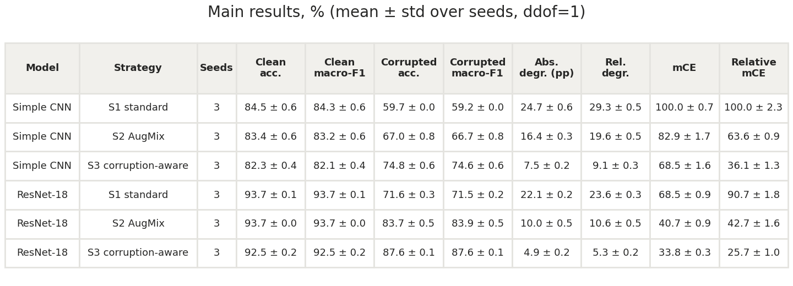
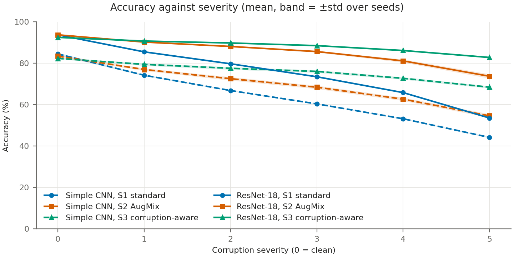
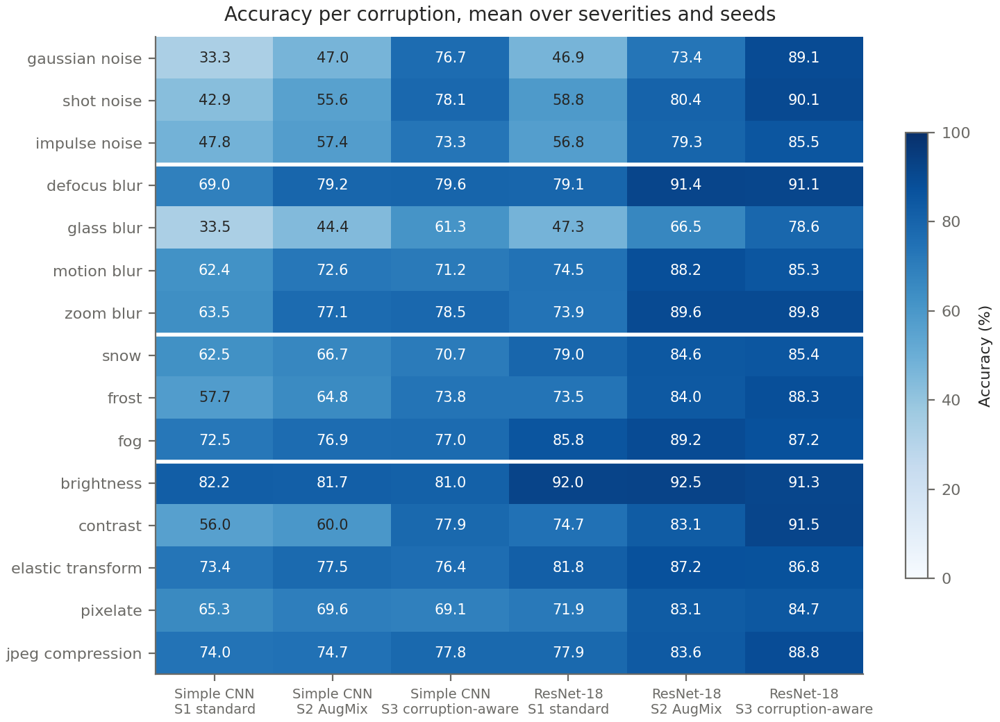
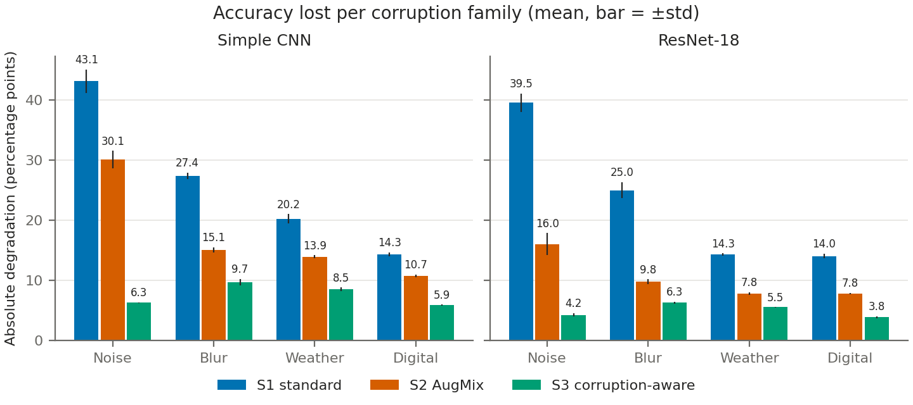
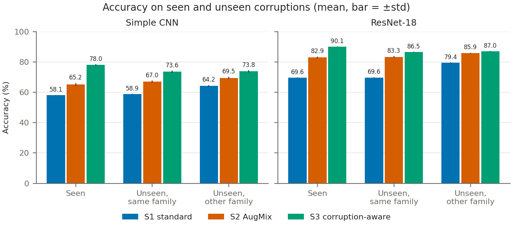
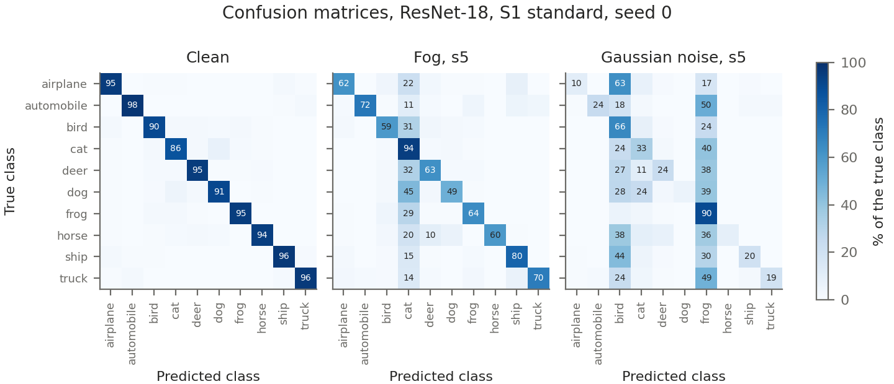
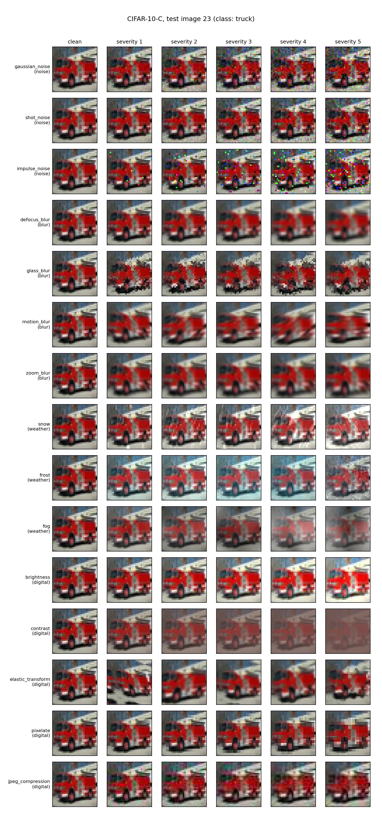
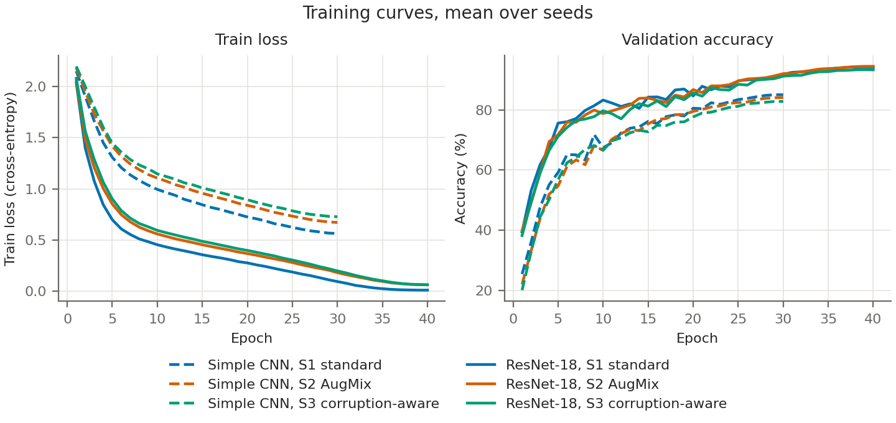

<!-- Generated by `python -m scripts.build_report` from report/report.template.md. Edit the template, not this file. -->

# How Well Do Image Classifiers Survive Common Image Corruptions? A Study of a Simple CNN and ResNet-18 on CIFAR-10-C

*cifar10-robustness-study contributors*

## Abstract

Image classifiers are usually tested on clean images like the ones they were trained on, but deployed cameras produce noisy, blurred, foggy or compressed images. We measure how much accuracy two classifiers trained from scratch on CIFAR-10, a small Simple CNN and ResNet-18, lose on CIFAR-10-C, which applies 15 corruption types at 5 severity levels to the CIFAR-10 test images. We compare three training strategies with all other settings fixed: standard training (crop and flip), AugMix, and corruption-aware training on four corruption types that we implement ourselves and call "seen". Each of the 6 configurations is trained with 3 seeds. With standard training, ResNet-18 reaches 93.7% clean accuracy but 71.6% mean accuracy on corrupted images, a drop of 22.1 pp; the drop grows with severity in every configuration. ResNet-18 is more accurate than the Simple CNN on both clean and corrupted images, but the error that the corruptions add falls much less than its total error (relative mCE 90.7% against mCE 68.5%, with the Simple CNN as the 100% reference). Both robustness strategies reduce the drop for both models. For ResNet-18, AugMix lowers mCE to 40.7% at no measurable cost in clean accuracy, and corruption-aware training lowers it to 33.8% at a clean-accuracy cost of 1.2 pp. Corruption-aware training helps most on the corruptions it was trained on, less on unseen corruptions from the same families, and least on the weather corruptions, which have no seen relative. Noise and blur cause the largest drops under standard training and brightness the smallest. All code, results and figures are in a public repository and can be reproduced on free cloud GPUs.

## 1 Introduction and motivation

A model that is accurate on a benchmark is not necessarily accurate on the images a real camera produces. Sensor noise, motion, defocus, weather, poor lighting and lossy compression all change the pixels without changing what the image shows. A person still recognises a foggy truck; a classifier trained only on clean images often does not. This kind of change between training and test data is called distribution shift, and a model that keeps its accuracy under it is called robust.

Hendrycks and Dietterich [3] made this measurable for small images with CIFAR-10-C: the CIFAR-10 test set [1] with 15 corruption types, each at 5 severities. This project uses that benchmark to answer five research questions at a scale that fits free cloud GPUs:

- **RQ1.** How much do a Simple CNN and ResNet-18 degrade on corrupted images compared with clean ones? *Hypothesis: both degrade substantially, and the drop grows with severity.*
- **RQ2.** Does a stronger architecture also mean more robustness, or only higher clean accuracy? *Hypothesis: ResNet-18 has higher clean and corrupted accuracy, but its relative degradation may not be much smaller.*
- **RQ3.** Do AugMix [4] and corruption-aware training reduce degradation compared with standard training? *Hypothesis: yes, both, with the largest gains on corruption types similar to those seen in training.*
- **RQ4.** Does corruption-aware training generalise to corruption types not seen during training? *Hypothesis: partly; gains are large on seen corruptions and smaller on unseen ones.*
- **RQ5.** Which corruption families (noise, blur, weather, digital) hurt the most? *Hypothesis: noise and blur cause the largest drops, brightness the smallest.*

The contribution is a careful, controlled and reproducible comparison, not a new method. Every number in this report is filled in by a script from result files the code produced, and the limitations are stated in Section 7.

## 2 Related work

**CIFAR-10 and ResNet.** CIFAR-10 [1] has 60,000 colour images of 32x32 pixels in 10 classes. Residual networks [2] add skip connections that let deep convolutional networks train well; ResNet-18 is a common choice for CIFAR-10 when adapted to small images.

**Common corruptions.** Hendrycks and Dietterich [3] introduced ImageNet-C and CIFAR-10-C, with 15 corruptions in four families (noise, blur, weather, digital) at 5 severities, and the mean Corruption Error (mCE), which normalises a model's error by a baseline model's error on each corruption. We use their CIFAR-10-C data unchanged and their mCE definition with our own baseline (Section 3.5).

**Data augmentation for robustness.** AugMix [4] mixes several randomly augmented versions of an image and, in its full form, adds a Jensen-Shannon consistency loss between them. It improved corruption robustness on CIFAR-10-C without training on the test corruptions; its operations are chosen to avoid overlapping with them. We use the augmentation without the consistency loss (Section 7).

**Training on corruptions and generalising across them.** Geirhos et al. [5] found that networks trained on specific image distortions became robust to those distortions but often not to other distortions. This is why we hold out corruption types from corruption-aware training and report seen and unseen corruptions separately (RQ4).

**Distribution shift more broadly.** Recht et al. [6] built new test sets for CIFAR-10 and ImageNet following the original procedures and found accuracy drops even under this mild, natural shift. Schneider et al. [7] showed that re-estimating batch-normalisation statistics on corrupted data at test time improves corruption robustness; we do not use test-time adaptation, and list it as future work.

## 3 Methodology

### 3.1 Data and split

We train on CIFAR-10 [1]. The 50,000 training images are split once into 45,000 for training and 5,000 for validation, stratified with 500 per class, using split seed 42; the indices are stored in the repository so every run uses the same split, whatever its training seed. Images are normalised with the per-channel mean and standard deviation of the 45,000 training images. The 10,000 test images are used only for the final evaluation, and the validation split only to monitor training. The model after the last epoch is evaluated; there is no early stopping or checkpoint selection.

Corrupted images come from CIFAR-10-C [3], downloaded from its Zenodo record and checked against the published archive checksum. CIFAR-10-C is read only by the evaluation code and the figure that shows sample images; a test in the repository fails if training code imports it.

### 3.2 Models

**Simple CNN.** Three convolution blocks with 32, 64 and 128 channels (3x3 convolutions with padding 1, batch normalisation, ReLU, max-pooling and dropout of 0.25 after each block), then a hidden layer of 256 units with dropout of 0.5 and a linear output layer; 666,858 trainable parameters.

**ResNet-18.** The usual CIFAR adaptation of ResNet-18 [2]: a 3x3 stride-one stem without max-pooling, four stages of two basic residual blocks with 64, 128, 256 and 512 channels, global average pooling and a linear layer; 11,173,962 trainable parameters. Both models are written in the repository and trained from scratch; no pre-trained weights are used.

### 3.3 Training strategies

Only the transform applied to training images differs between strategies. All of them end with conversion to a tensor and normalisation.

- **S1 standard:** `RandomCrop(32, padding=4)` and a random horizontal flip.
- **S2 AugMix:** S1, then torchvision's `AugMix` with severity=3, mixture_width=3, chain_depth=-1, alpha=1.0 and `all_ops=False`, which keeps AugMix's operations from overlapping with CIFAR-10-C corruptions, as in [4]. No Jensen-Shannon consistency loss.
- **S3 corruption-aware:** S1, then with probability 0.5 one of the four **seen** corruptions (Gaussian noise, defocus blur, contrast, JPEG compression), chosen uniformly, at a severity chosen uniformly from severities 1-5. We implemented these four corruptions ourselves following the published formulas and severity parameters of [3]; they are applied to training images and never read CIFAR-10-C files.

### 3.4 Seen and unseen corruptions

Some unseen corruptions are close relatives of a seen one (shot and impulse noise of Gaussian noise; the other blurs of defocus blur). We therefore split the 15 corruptions into three groups, fixed before any training:

| Group | Corruptions |
|---|---|
| Seen | gaussian_noise, defocus_blur, contrast, jpeg_compression |
| Unseen, same family | shot_noise, impulse_noise, glass_blur, motion_blur, zoom_blur, brightness, elastic_transform, pixelate |
| Unseen, other family | snow, frost, fog |

The digital family is mixed: brightness and elastic transform are not much like contrast or JPEG compression. For that reason we also report results per corruption, not only per group. Our family assignment follows the project's research plan and differs from [3] in one place: [3] counts brightness as a weather corruption, while we count it as digital, so our weather family is snow, frost and fog. This changes the per-family results in Section 5.5, not the per-corruption ones.

### 3.5 Metrics

Each model is evaluated on 76 test conditions of 10,000 images each: the clean test set and 15 corruptions x 5 severities. Accuracy and macro-F1 (the F1-score computed per class and averaged with equal weight over the 10 classes) are computed for every condition. The 4 extra corruptions that CIFAR-10-C also provides are not evaluated and never enter any average.

- **Mean corrupted accuracy:** the unweighted mean accuracy over the 75 conditions with a corruption.
- **Absolute degradation:** clean accuracy minus corrupted accuracy, in percentage points (pp).
- **Relative degradation:** absolute degradation divided by clean accuracy.
- **Corruption Error and mCE** [3]: for corruption *c*, `CE_c = Σ_s E(c, s) / Σ_s E_base(c, s)`, where `E(c, s)` is the error (one minus accuracy) at severity *s* and the sums run over the five severities. mCE is the mean of `CE_c` over the 15 corruptions. The baseline is our Simple CNN with standard training, with the baseline error of each condition averaged over its 3 seeds, so the baseline's own mCE is 100% by definition (100.0% ± 0.7% over its seeds). Lower is better.
- **Relative mCE:** the same ratio computed on the increase in error over each model's own clean error, `Σ_s (E(c, s) − E_clean) / Σ_s (E_base(c, s) − E_base_clean)`, averaged over the 15 corruptions. It separates being robust from being more accurate overall.

Every value is reported as the mean ± sample standard deviation over the 3 seeds. To compare two configurations we pair runs by seed and take the mean difference. We call a difference **within seed noise** when it is smaller than the larger of the two configurations' seed standard deviations, and **beyond seed noise** otherwise. With only 3 seeds this is a rule of thumb, not a significance test (Section 7). A hypothesis is called *supported* only when the numbers that bear on it are beyond seed noise.

## 4 Experimental setup

| Setting | Value (identical for all runs) |
|---|---|
| Optimiser | SGD with Nesterov momentum 0.9, weight decay 5e-4 |
| Learning rate | learning rate 0.1, cosine annealing to zero over all epochs, no warm-up |
| Batch size | batch size 128, mixed precision on the GPU |
| Epochs | Simple CNN 30 epochs, ResNet-18 40 epochs |
| Seeds | seeds 0, 1 and 2 (Python, NumPy and PyTorch seeded; cuDNN deterministic) |
| Matrix | 2 models x 3 strategies x 3 seeds = 18 training runs; the optional no-augmentation ablation (S0) was not run |

The ResNet-18 epoch count was fixed at 40 epochs before the main runs, from the measured time per epoch of a pilot run on the target GPU (`results/pilot_report.md`), not from any test or CIFAR-10-C result. Within that budget the training curves (Figure 8) show the training loss still falling slowly and the validation accuracy levelling off in the last epochs.

**Hardware and software.** GPU: one NVIDIA Tesla T4 (18 runs). Software, as recorded in each run's metadata: Python 3.13.16 (18 runs); PyTorch 2.11.0+cu130 (11 runs), 2.14.1+cu130 (7 runs); torchvision 0.26.0+cu130 (11 runs), 0.29.1+cu130 (7 runs). The platforms' preinstalled PyTorch versions were used, and Colab's version changed between sessions (Section 7). Code version: commit 7d334eb (17 runs), 004edc3 (1 run); the two commits differ only in comment lines in the ResNet-18 configuration files. Runs with uncommitted changes: 0.

**Compute used.** Training took 9.2 GPU hours in total (finished epochs only; evaluation and session setup excluded). The runs were made in free Google Colab sessions on 2026-11-04 and 2026-11-09; one run, `resnet18-augmix-s2`, was trained from scratch on a free Kaggle T4 on 2026-11-10 at the same commit, after Colab's free GPU limit was reached (`results/RUNLOG.md`). On Colab, training with AugMix took 5.9 times as long as standard training for the Simple CNN and 4.7 times as long for ResNet-18; corruption-aware training took 1.4 and 1.4 times as long. The AugMix transform runs on the CPU in the data-loading workers, which limits its speed. The Kaggle run trained in 41.7 minutes, against 77.4 minutes on average for the two Colab runs of the same configuration, probably because the Kaggle machine gave the data-loading workers more CPU; we did not record the CPU count of either platform.

## 5 Results

Table 1 summarises the six configurations; Figure 1 shows the same table as an image. Figures 2-6 break the results down by severity, corruption, family, seen/unseen group and class.

**Table 1.** Main results, mean ± std over 3 seeds. mCE and relative mCE use the Simple CNN with standard training as the 100% reference; lower is better.

| Model | Strategy | Clean acc. | Clean macro-F1 | Mean corrupted acc. | Abs. degradation | Rel. degradation | mCE | Relative mCE |
|---|---|---|---|---|---|---|---|---|
| Simple CNN | S1 standard | 84.5% ± 0.6% | 84.3% | 59.7% ± 0.0% | 24.7 pp | 29.3% | 100.0% ± 0.7% | 100.0% ± 2.3% |
| Simple CNN | S2 AugMix | 83.4% ± 0.6% | 83.2% | 67.0% ± 0.8% | 16.4 pp | 19.6% | 82.9% ± 1.7% | 63.6% ± 0.9% |
| Simple CNN | S3 corruption-aware | 82.3% ± 0.4% | 82.1% | 74.8% ± 0.6% | 7.5 pp | 9.1% | 68.5% ± 1.6% | 36.1% ± 1.3% |
| ResNet-18 | S1 standard | 93.7% ± 0.1% | 93.7% | 71.6% ± 0.3% | 22.1 pp | 23.6% | 68.5% ± 0.9% | 90.7% ± 1.8% |
| ResNet-18 | S2 AugMix | 93.7% ± 0.0% | 93.7% | 83.7% ± 0.5% | 10.0 pp | 10.6% | 40.7% ± 0.9% | 42.7% ± 1.6% |
| ResNet-18 | S3 corruption-aware | 92.5% ± 0.2% | 92.5% | 87.6% ± 0.1% | 4.9 pp | 5.3% | 33.8% ± 0.3% | 25.7% ± 1.0% |

*Figure 1. The main results as an image, for slides and the README.*

Macro-F1 follows accuracy closely when averaged over all corrupted conditions (for example 71.5% macro-F1 against 71.6% accuracy for ResNet-18 with standard training), so the rest of this section uses accuracy. Section 5.6 looks at the per-class picture.

### 5.1 RQ1: How much do the models degrade?

With standard training, mean accuracy falls from 84.5% to 59.7% for the Simple CNN, a drop of 24.7 pp (29.3% of its clean accuracy), and from 93.7% to 71.6% for ResNet-18, a drop of 22.1 pp (23.6%). The drop grows with severity (Figure 2): for ResNet-18 with standard training it is 8.2 pp at severity 1 and 40.2 pp at severity 5; for the Simple CNN, 10.3 pp and 40.3 pp. The mean drop rises at every severity step in all six configurations (Simple CNN: yes, yes, yes; ResNet-18: yes, yes, yes, for S1, S2 and S3), including the robust ones, whose drop at severity 5 is still 20.0 pp (AugMix) and 9.7 pp (corruption-aware) for ResNet-18.

*Figure 2. Mean accuracy over the 15 corruptions at each severity (severity 0 is the clean test set), mean over seeds.*

**Verdict: supported.** Both models lose a large share of their accuracy under standard training, and the drop grows with severity in every configuration.

### 5.2 RQ2: Does a stronger architecture mean more robustness?

With standard training, ResNet-18 is more accurate than the Simple CNN on clean images (by 9.2 pp, beyond seed noise) and on corrupted images (by 11.9 pp, beyond seed noise). Its mCE is 68.5%, lower than the baseline by 31.5 pp.

Most of that advantage, however, is the advantage it already has on clean images. ResNet-18's absolute drop is smaller by only 2.6 pp and its relative drop by 5.7 pp (both beyond seed noise). Its relative mCE, which counts only the error added by the corruptions, is 90.7%: lower than the baseline by 9.3 pp, against 31.5 pp for mCE. Per seed, the relative-mCE difference is -5.2 pp, -11.7 pp and -10.9 pp, so it varies more across seeds than the mCE difference but is beyond seed noise. With the robust strategies the architecture gap in relative mCE is 21.0 pp with AugMix and 10.3 pp with corruption-aware training.

**Verdict: partly supported.** ResNet-18 has higher clean and corrupted accuracy, as predicted. Its relative degradation is smaller beyond seed noise, so the stronger architecture is somewhat more robust and not only more accurate; but under standard training the reduction is modest compared with the gain in clean accuracy, which is the second half of the hypothesis.

### 5.3 RQ3: Do AugMix and corruption-aware training reduce degradation?

Both strategies reduce degradation for both models, and every robustness comparison with standard training in Table 2 (the first four value columns) is beyond seed noise.

**Table 2.** Change against standard training (strategy minus standard, mean of the paired seed differences).

| Model | Strategy | Mean corrupted acc. | Abs. degradation | mCE | Relative mCE | Clean acc. |
|---|---|---|---|---|---|---|
| Simple CNN | S2 AugMix | 7.3 pp | -8.4 pp | -17.1 pp | -36.4 pp | -1.1 pp (beyond seed noise) |
| Simple CNN | S3 corruption-aware | 15.1 pp | -17.2 pp | -31.5 pp | -63.9 pp | -2.2 pp (beyond seed noise) |
| ResNet-18 | S2 AugMix | 12.1 pp | -12.1 pp | -27.8 pp | -48.1 pp | 0.0 pp (within seed noise) |
| ResNet-18 | S3 corruption-aware | 16.0 pp | -17.2 pp | -34.7 pp | -65.0 pp | -1.2 pp (beyond seed noise) |

Corruption-aware training gives the larger improvement for both models; for ResNet-18 it raises mean corrupted accuracy by 16.0 pp against 12.1 pp for AugMix. Its improvement has a price on clean images: clean accuracy is lower by 2.2 pp for the Simple CNN and 1.2 pp for ResNet-18, both beyond seed noise. AugMix costs the Simple CNN 1.1 pp of clean accuracy but leaves ResNet-18's unchanged within seed noise.

Per family (Figure 4 and the heatmap in Figure 3), the largest gains are on noise, except for the Simple CNN with AugMix, where noise (12.0 pp) and blur (11.2 pp) gain about the same. For ResNet-18, corruption-aware training gains 34.1 pp on noise, 17.5 pp on blur, 9.0 pp on digital and 7.5 pp on weather; AugMix gains 23.6 pp, 15.2 pp, 6.2 pp and 6.5 pp. Noise and blur are the families that contain a seen corruption with close relatives, and also the families where standard training loses the most (Section 5.5), so part of the larger gain there is simply more room to improve.

*Figure 3. Accuracy per corruption (mean over severities and seeds) for each configuration.*

*Figure 4. Mean absolute accuracy drop per corruption family, per strategy and model.*

**Verdict: supported.** Both strategies reduce degradation for both models, beyond seed noise. For corruption-aware training the gains are largest where training saw similar corruptions (the seen group and the noise family; Section 5.4). AugMix, whose operations were chosen not to resemble the test corruptions, also gains most on noise and blur. Corruption-aware training lowers clean accuracy by a point or two (Table 2), which the hypothesis did not anticipate.

### 5.4 RQ4: Does corruption-aware training generalise to unseen corruptions?

Figure 5 and Table 3 split the corrupted conditions into the three groups of Section 3.4.

**Table 3.** Accuracy per group (mean ± std over 3 seeds) and gain against standard training.

| Model | Group | Standard | Corruption-aware | Gain | AugMix | Gain |
|---|---|---|---|---|---|---|
| Simple CNN | Seen | 58.1% | 78.0% ± 0.5% | 19.9 pp | 65.2% | 7.2 pp |
| Simple CNN | Unseen, same family | 58.9% | 73.6% ± 0.6% | 14.7 pp | 67.0% | 8.1 pp |
| Simple CNN | Unseen, other family | 64.2% | 73.8% ± 0.7% | 9.6 pp | 69.5% | 5.3 pp |
| ResNet-18 | Seen | 69.6% | 90.1% ± 0.1% | 20.5 pp | 82.9% | 13.3 pp |
| ResNet-18 | Unseen, same family | 69.6% | 86.5% ± 0.2% | 16.9 pp | 83.3% | 13.7 pp |
| ResNet-18 | Unseen, other family | 79.4% | 87.0% ± 0.2% | 7.5 pp | 85.9% | 6.5 pp |

*Figure 5. Accuracy on seen corruptions, unseen corruptions from the same families, and unseen corruptions from other families.*

For ResNet-18, corruption-aware training gains 20.5 pp on the seen corruptions, 16.9 pp on unseen corruptions from the same families and 7.5 pp on snow, frost and fog. The gain on seen corruptions exceeds the gain on unseen same-family corruptions by 3.6 pp (beyond seed noise) and the gain on other-family corruptions by 13.0 pp (beyond seed noise); the Simple CNN shows the same order (5.2 pp and 10.3 pp). So the training transfers well to close relatives of what it saw, and much less to corruptions with no seen relative.

Two observations limit how much of this gap is about seen versus unseen. First, AugMix, which trains on none of these corruptions, shows a similar pattern for ResNet-18 between the seen and other-family groups (6.8 pp, beyond seed noise), while its seen and same-family gains differ only within seed noise. Part of the smaller gain on weather corruptions therefore holds for any strategy we tried: standard training already does better on them (79.4% against 69.6% on the seen group), which leaves less room. Second, even on the other-family group, corruption-aware training is the most accurate of the three strategies for both models.

**Verdict: supported.** Gains are largest on the seen corruptions, smaller on unseen corruptions of the same families and smallest on unseen corruptions of other families, all beyond seed noise. The gains on unseen corruptions are still substantial, and the weather group is harder to improve for AugMix too, so this result does not show that corruption-aware training is unusually narrow.

### 5.5 RQ5: Which corruption families hurt the most?

With standard training the mean absolute drop per family for the Simple CNN is 43.1 pp on noise, 27.4 pp on blur, 20.2 pp on weather and 14.3 pp on digital; for ResNet-18 it is 39.5 pp, 25.0 pp, 14.3 pp and 14.0 pp (Figure 4). Noise is the worst family for both models, ahead of blur by 15.8 pp (Simple CNN) and 14.6 pp (ResNet-18); blur is ahead of the third family by 7.1 pp and 10.7 pp. All four gaps are beyond seed noise. For ResNet-18, weather and digital are close: their difference is within seed noise, so neither is clearly the mildest family. This comparison depends on our family assignment (Section 3.4): brightness, the mildest corruption, counts as digital here but as weather in [3].

Per corruption, the largest drops under standard training are Gaussian noise (46.8 pp for ResNet-18) and glass blur (46.4 pp); the difference between them is within seed noise for ResNet-18 and within seed noise for the Simple CNN, so they tie. Brightness causes the smallest drop for both models (2.3 pp for the Simple CNN, 1.6 pp for ResNet-18), clearly below the next mildest corruption (Simple CNN: beyond seed noise; ResNet-18: beyond seed noise).

After robust training the ranking changes. With corruption-aware training, blur becomes the worst family for both models and glass blur the worst corruption (13.9 pp for ResNet-18, against 3.3 pp for Gaussian noise); with AugMix, glass blur is also the worst corruption for both models. Glass blur is unseen by both strategies, and it stays the hardest corruption after robust training.

**Verdict: supported, for standard training.** Noise and blur cause the largest drops and brightness the smallest, beyond seed noise. The worst single corruption is a tie between Gaussian noise and glass blur, and the ranking of families depends on the training strategy.

### 5.6 Which classes collapse?

Figure 6 shows the confusion matrices of ResNet-18 with standard training (seed 0) on clean images, fog at severity 5 and Gaussian noise at severity 5. On clean images predictions are spread evenly: averaged over the three seeds, the most predicted class receives only 10.2% of the predictions. Under heavy noise the model sends most images to two classes: averaged over the three seeds, 50.9% of all predictions are "frog" and 30.2% "bird". Under heavy fog 29.0% of predictions are "cat". The same class is the most predicted in every seed for both corruptions (noise: yes; fog: yes). The robust strategies reduce this collapse under noise: the share of the most predicted class falls to 24.3% with AugMix and 10.5% with corruption-aware training. Under fog it changes less: 19.7% "cat" with AugMix and 19.9% "cat" with corruption-aware training. The Simple CNN collapses further under noise with standard training (85.5% "frog"). This is the kind of per-class failure that a single accuracy number hides.

*Figure 6. Confusion matrices of ResNet-18 with standard training (seed 0), in % of each true class.*

Figure 7 shows what the corruptions look like on one test image, and Figure 8 the training curves.

*Figure 7. One CIFAR-10 test image under all 15 corruptions at severities 1-5.*

*Figure 8. Training loss and validation accuracy per epoch, mean over seeds.*

## 6 Discussion

**Clean accuracy is not robustness, but it helps.** The stronger architecture made the models more accurate on corrupted images mostly because it made them more accurate in general (RQ2). The training strategy changed robustness far more: for ResNet-18 the strategy moved relative mCE from 90.7% to 25.7%, while the architecture moved it, under standard training, from 100.0% to 90.7%. A model chosen only by its clean test accuracy can therefore be a poor choice for degraded inputs, and a robustness evaluation like this one can be added to model testing before deployment.

**Cheap training changes give large gains here.** Neither strategy needs more data or a bigger model. AugMix improved ResNet-18 without a measurable cost in clean accuracy, using operations chosen not to overlap with the test corruptions. This suggests it is worth trying when the kinds of degradation to expect are unknown, though we tested it on one dataset only. Corruption-aware training gave the largest gains but costs some clean accuracy, and its benefit was largest for corruptions like those it trained on. In practice this suggests training on the degradations one expects (for example the noise and compression of a known camera pipeline) and checking separately on degradations one did not plan for. On Colab, ResNet-18 with AugMix took 4.7 times as long to train as with standard training, a cost to weigh against its benefit.

**Possible real-world relevance, stated with care.** This study uses 32x32 images in 10 classes of everyday objects and synthetic corruptions. It does not show how any deployed system behaves. Corruption robustness may matter wherever images come from cheap cameras, bad weather or compressed uploads. Our results may suggest that, in such settings, the training procedure deserves as much attention as the architecture, and that robustness should be measured per corruption and per class, since a model can collapse onto one class under heavy noise (Section 5.6). Whether these findings carry over to larger images, other datasets or real (not synthetic) degradations would need to be tested; Recht et al. [6] show that even natural re-collections of a test set can lower accuracy.

## 7 Limitations

- **One small dataset.** All results are on CIFAR-10 and CIFAR-10-C: 32x32 images, 10 classes and synthetic corruptions. They may not hold for larger images, other domains or real degradations.
- **Three seeds and a simple noise rule.** Each configuration has 3 seeds. "Within seed noise" compares a mean difference with the seed standard deviations; it is not a significance test, and with 3 seeds the standard deviations themselves are uncertain. No p-values are reported.
- **Final-epoch checkpoint.** The model after the last epoch is evaluated, with no early stopping or checkpoint selection, so that strategies are compared the same way. Other checkpoint rules could give slightly different numbers.
- **Fixed, short training.** The Simple CNN is trained for 30 epochs and ResNet-18 for 40 epochs, chosen from the compute budget. Longer training could change clean accuracy and robustness, and could change the strategies by different amounts.
- **AugMix without its consistency loss.** We use the AugMix augmentation without the Jensen-Shannon consistency loss of [4], to save compute. Results for full AugMix may differ.
- **Our own seen corruptions.** Corruption-aware training uses our implementations of the four seen corruptions, following the published formulas and severity parameters of [3]. When we applied them to test images and compared the output with CIFAR-10-C, our defocus blur and contrast matched almost pixel for pixel, but our JPEG compression matched only in mean strength (`PROGRESS.md`, Phase 03): the published images show stronger colour artefacts on some images, probably because of a different JPEG library, which we did not confirm. We did not tune it against CIFAR-10-C, because that would leak test data into training. This could slightly understate corruption-aware training on JPEG compression.
- **Mixed digital family.** Brightness and elastic transform are not much like the seen digital corruptions (contrast and JPEG compression), yet they fall in the "unseen, same family" group. Per-corruption results (Figure 3) are reported for this reason. The family assignment also differs from [3], which counts brightness as weather (Section 3.4).
- **Different compute platforms and software versions.** Seventeen runs were trained on Colab and one (`resnet18-augmix-s2`) on Kaggle, on the same GPU model and commit, after Colab's free GPU limit was reached; its partial Colab run was not used. Colab's preinstalled PyTorch changed between sessions, so the runs used two versions (2.11.0+cu130 (11 runs), 2.14.1+cu130 (7 runs)). Training-time comparisons across platforms are not like for like (Section 4).
- **Interrupted runs.** Three runs were interrupted and resumed from their last checkpoint: `cnn-standard-s0` (the pilot, disconnected on purpose to test resuming), `cnn-augmix-s0` and `resnet18-standard-s2` (`results/pilot_report.md`, `results/RUNLOG.md`). A resumed run does not replay the exact order of training images and augmentations, so it is not bit-for-bit identical to an uninterrupted run with the same seed; we accepted this before the runs, as the same seed is not bit-for-bit reproducible on a GPU anyway. The evaluation of `resnet18-corruption_aware-s1` was cut off once and rerun in full in a later session; evaluation has no randomness.
- **One run at an earlier commit.** The pilot run `cnn-standard-s0` used commit `004edc3`; it differs from the commit of the other runs only in comment lines in the ResNet-18 configuration files.
- **Fixed design choices.** All scientific choices (split, epochs, strategies and their parameters, seen and unseen lists, metric definitions) were fixed before the main runs and recorded with a change log. The changes made after that were: the ResNet-18 epoch count, fixed at 40 epochs from measured GPU time on 2026-11-04 before any ResNet-18 run; the acceptance of the JPEG mismatch and of resumed runs above; the move of one run to Kaggle on 2026-11-10; and changes to the local software pins, folder layout, environment variables, run metadata and the rule that a shortened training run is always labelled a test run, none of which affects any result. None was made by looking at test or CIFAR-10-C results.
- **No adversarial or natural shift.** We study common synthetic corruptions only, not adversarial examples or natural distribution shift.

## 8 Conclusion and future work

On CIFAR-10-C, a Simple CNN and ResNet-18 trained in the standard way lose a large part of their accuracy on corrupted images, more so at higher severity, and most on noise and blur. ResNet-18 is more accurate on both clean and corrupted images, but most of its advantage on corrupted images comes from its higher clean accuracy. AugMix and corruption-aware training both reduce the loss substantially for both models. Corruption-aware training gives the largest gains, at a small cost in clean accuracy, and generalises well to close relatives of the corruptions it trained on but less to unrelated ones; AugMix gives a smaller gain without a measurable clean-accuracy cost for ResNet-18.

Possible next steps: test-time adaptation of batch-normalisation statistics [7]; the full AugMix with its consistency loss; pre-trained models, wider networks, mobile architectures or small vision transformers; calibration on corrupted images (are the models overconfident?); natural distribution shift such as CIFAR-10.1 [6]; adversarial robustness; and the same pipeline on a medical or agricultural image dataset.

## References

1. Krizhevsky, A. (2009). *Learning Multiple Layers of Features from Tiny Images*. Technical report, University of Toronto. https://www.cs.toronto.edu/~kriz/learning-features-2009-TR.pdf
2. He, K., Zhang, X., Ren, S., & Sun, J. (2016). Deep Residual Learning for Image Recognition. In *Proceedings of the IEEE Conference on Computer Vision and Pattern Recognition (CVPR)*, pp. 770–778. https://doi.org/10.1109/CVPR.2016.90
3. Hendrycks, D., & Dietterich, T. (2019). Benchmarking Neural Network Robustness to Common Corruptions and Perturbations. In *International Conference on Learning Representations (ICLR)*. https://openreview.net/forum?id=HJz6tiCqYm. Data: CIFAR-10-C, Zenodo, https://doi.org/10.5281/zenodo.2535967
4. Hendrycks, D., Mu, N., Cubuk, E. D., Zoph, B., Gilmer, J., & Lakshminarayanan, B. (2020). AugMix: A Simple Data Processing Method to Improve Robustness and Uncertainty. In *International Conference on Learning Representations (ICLR)*. https://openreview.net/forum?id=S1gmrxHFvB
5. Geirhos, R., Temme, C. R. M., Rauber, J., Schütt, H. H., Bethge, M., & Wichmann, F. A. (2018). Generalisation in humans and deep neural networks. In *Advances in Neural Information Processing Systems 31 (NeurIPS 2018)*, pp. 7549–7561. https://proceedings.neurips.cc/paper_files/paper/2018/hash/0937fb5864ed06ffb59ae5f9b5ed67a9-Abstract.html
6. Recht, B., Roelofs, R., Schmidt, L., & Shankar, V. (2019). Do ImageNet Classifiers Generalize to ImageNet? In *Proceedings of the 36th International Conference on Machine Learning (ICML)*, PMLR 97, pp. 5389–5400. https://proceedings.mlr.press/v97/recht19a.html
7. Schneider, S., Rusak, E., Eck, L., Bringmann, O., Brendel, W., & Bethge, M. (2020). Improving robustness against common corruptions by covariate shift adaptation. In *Advances in Neural Information Processing Systems 33 (NeurIPS 2020)*, pp. 11539–11551. https://papers.nips.cc/paper_files/paper/2020/hash/85690f81aadc1749175c187784afc9ee-Abstract.html
